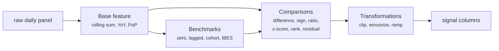

# feature_kit

**feature_kit** turns panels of daily time series, such as alternative-data KPIs like card spend, app downloads or web traffic, into forecast features and signals for downstream alpha models. It is built on [Polars](https://pola.rs/).

A pipeline has four stages. You can use each stage on its own or chain all four with [`FeatureBuilder`](api/builder.md):



| Stage | Question it answers | Example output column |
|---|---|---|
| **Base feature** | What is the metric doing? | `SALES__YOY_GROWTH__QUADWEEKLY` |
| **Benchmark** | What should we compare that to? | `SALES__YOY_GROWTH__QUADWEEKLY__LAG1MONTH` |
| **Comparison** | How far is the feature from the benchmark? | `SALES__YOY_GROWTH__QUADWEEKLY__VS__ZERO_BENCHMARK__DIFFERENCE` |
| **Transformation** | Make the signal model-ready | same columns, clipped or scaled |

## Minimal example

```python
from feature_kit import (
    FeatureBuilder, Param,
    YOYGrowthBaseFeature, ZeroBenchmark, LaggedYOYGrowthBenchmark,
    DifferenceComparison, SignComparison, ClipTransformation,
)

params = Param(keys=["specid"], metrics=["SALES"])

builder = FeatureBuilder(
    params=params,
    base_feature=YOYGrowthBaseFeature(params),
    benchmarks=[ZeroBenchmark(params), LaggedYOYGrowthBenchmark(params)],
    comparisons=[DifferenceComparison(params), SignComparison(params)],
    transformations=[ClipTransformation(-1.0, 1.0)],
)
signals = builder.compute(raw_df)   # one row per (specid, DATADATE)
```

## Where to go next

- **[Getting started](getting-started.md)**: installation, input format and a runnable end-to-end example.
- **[Design overview](design.html)**: architecture, workflow flowchart and design decisions on one page.
- **[Concepts](concepts.md)**: column naming, how benchmarks align by date, and how features are paired with benchmarks.
- **[User guide](guide/base-features.md)**: what each component computes and when to use it.
- **[Known limitations](limitations.md)**: read this before using the signals in a backtest.
- **[API reference](api/index.md)**: every class, generated from the source docstrings.
